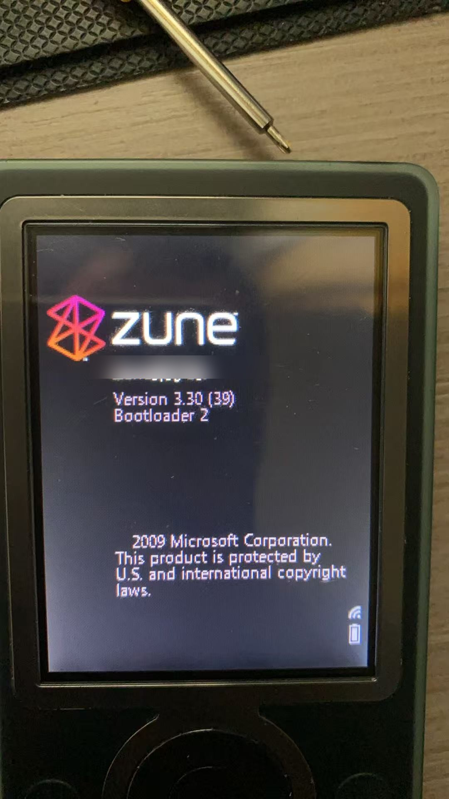
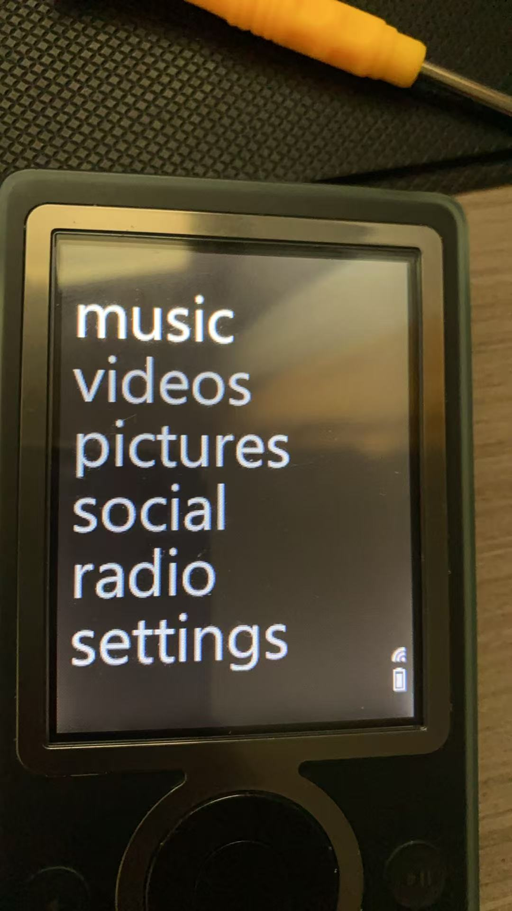
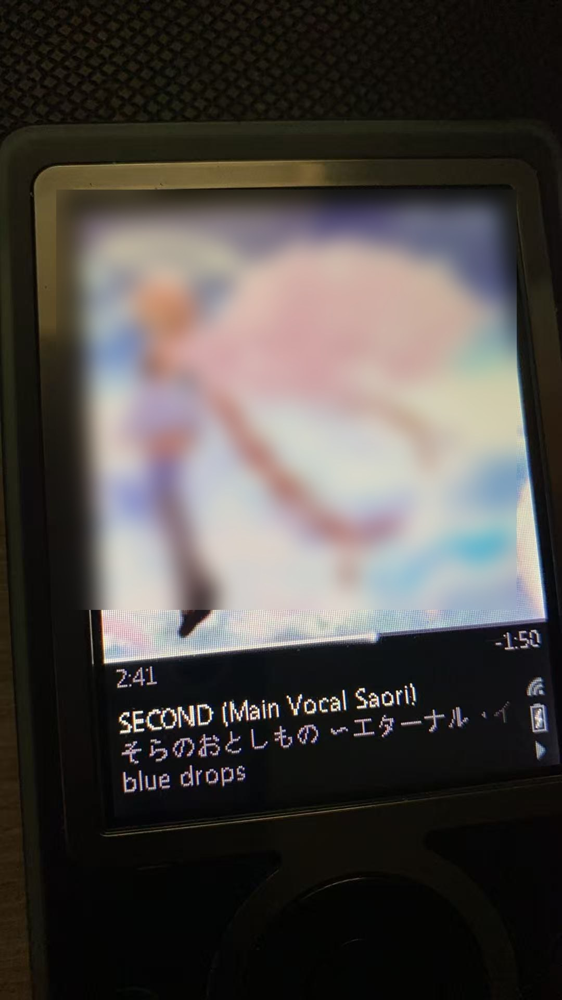
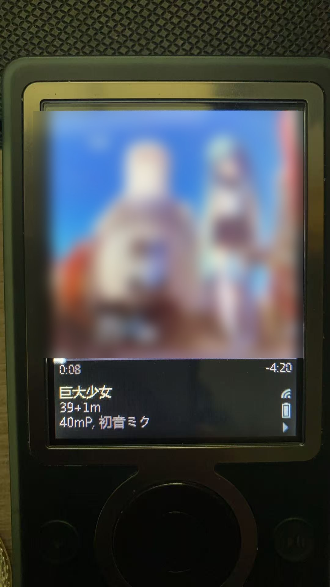

# Zune 30 (Keel) — Native CJK on official 3.3 firmware

**Status: working. Verified on real hardware (i.MX31 Zune 30, 30 GB).**

A first-generation Zune 30 running the *official* Zune **3.3 (39)** firmware now renders
Chinese and Japanese text natively — device name, song titles, artist names, all of it.

| What | Before | After |
|---|---|---|
| Device name | `Zune□□□` | `Zune示例名` |
| Song title | `□□□□` | `巨大少女` |
| Japanese title | `□□□□` | `そらのおとしもの ～エターナル・イ...` |
| Artist | `□□, □□□` | `40mP, 初音ミク` |

| Boot (device name) | Main menu |
|---|---|
|  |  |

| Japanese title | Chinese title |
|---|---|
|  |  |

This is, as far as public documentation goes, not something that had been done before:

* The 2009 Chinese-community hack reached CJK only on **1.0 TEST / 1.4** firmware.
* `zune30-research` explicitly stopped at a *bootable* 3.3 and states in its README that
  the 3.3 compatibility image does **not** include Chinese.

This repository documents how it works and how to reproduce it — scripts and analysis
only, **no Microsoft firmware and no licensed fonts are distributed here**.

---

## TL;DR — the actual trick

The Zune 3.3 shell (`gemstone.exe`) does not use GDI text fallback. It loads its UI fonts
**directly from three ROM files**:

```
\Windows\ZegoeUI.ttf        (regular)
\Windows\ZegoeUI_L.ttf      (light)
\Windows\ZegoeUI_SB.ttf     (semibold — the default face)
```

So the only way to change what 3.3 renders is to **replace the contents of those ROM files
with a font that contains CJK glyphs**.

The catch: ROM has ~36 KB of free space and a full CJK font is hundreds of KB.
The solution: **compress `skin_default.gem` in place** (464 KB → 334 KB), which frees a
contiguous 130 KB tail, and extend that region over two unused `zdkscenes*.gem` slots —
163–180 KB of contiguous space for a hint-free CJK subset.

Everything else (registry `Zune\Fonts\*` locators, GDI `FontLink`, fallback fonts, boot-time
font loaders) was tried and **does not work on 3.3**. See `docs/lessons-learned.md`.

---

## Prerequisite: a bootloader that accepts modified images

Retail 3.3 EBoot verifies the `nk.bin` signature (MinCrypt + HAB). Any change to `nk.bin`
results in a refusal or a full format of the 150 MB system partition.

The unlock is the **1.0 TEST bootloader** (`EBoot`, sha256 prefix `11D94DE4…`, reports
`Bootloader 2`). It is signed with a key the production eFuses accept, and it does **not**
verify `nk.bin`. Once it is in NOR, arbitrary `nk.bin` images boot.

> ⚠️ This is the single most important asset. If it is ever replaced by a retail EBoot
> you cannot put it back: EBoot lives in NOR and HAB checks its signature on every boot.
> **Never let the Zune software "restore/repair" the device.**

See `docs/02-lax-bootloader.md` for how it was obtained and installed.

---

## Firmware layout (what we actually build)

```
nk.bin (B000FF container, 110 records, base 0x88200000, ram_start 0x88f90000)
 ├── official 3.3 image                    (from the user's own KeelBaseline.cab)
 ├── AUTH196 patch                         (re-wrap the legacy vault at boot)
 ├── firmware version string patch         (0x7cda6c: force 03.30.00039.00-00435)
 ├── skin_default.gem                      (compressed in place, flags |= 0x800)
 └── ZegoeUI*.ttf entries                  (all three point at one CJK TTF, compressed)
```

* `AUTH196` is built offline with the public `zune30-research` tooling from the owner's own
  NOR/vault backup. It is device-specific and must never be published.
* The CJK font is a **hint-free TrueType subset** (ASCII + kana + N most-frequent Han
  characters from the owner's library), renamed to `Zegoe UI Semibold`, CE-LZX compressed
  with **4096-byte blocks** (the CE decoder rejects other block sizes).

Sizes measured on hardware:

| Item | Value |
|---|---|
| ROM image span | 13,956,899 B |
| Free ROM tail | 36,496 B |
| Zegoe slots (contiguous) | 112,948 B |
| skin_default.gem | 464,259 → 333,565 B |
| Contiguous space used for font | 163,325 B (950 chars) / 180,776 B (1,050 chars) |
| Font, hint-free, 1,050 Han + kana + ASCII | 231,240 B → 177,460 B compressed |

---

## Repository layout

```
README.md                  this file
README.zh-CN.md            中文说明
docs/
  01-background.md         Zune 30 hardware, boot chain, protection layers
  02-lax-bootloader.md     the 1.0 TEST bootloader and why it matters
  03-nor-vault-backup.md   dumping NOR/vault without desoldering
  04-auth196.md            bootable 3.3 on a legacy vault
  05-font-mechanism.md     how gemstone loads fonts (the core discovery)
  06-rom-space.md          freeing contiguous ROM space safely
  07-sync-fix.md           fixing C00D11CD after firmware surgery
  08-reproduction.md       step-by-step tutorial
  09-lessons-learned.md    everything that did NOT work, and why
  10-publishing-checklist.md  privacy / de-identification / publication checklist
  ACKNOWLEDGEMENTS.md      itemised credits
scripts/
  build_cjk_font.py        subset + hint-strip + rename + CE-LZX size check
  patch_nk.py              version patch, skin compression, font injection, container rebuild
  write_device.ps1         safe writer for the 150 MB system partition (retry + hash verify)
NOTICE.md                  legal / no binaries / credits
```

---

## Quick reproduction (high level)

You need: a Zune 30, a ZIF-to-USB adapter, a **1.0 TEST** unit (or a way to install the
TEST EBoot), your own official 3.3 `KeelBaseline.cab`, and a TTF with CJK glyphs you are
licensed to use.

1. **Back up everything** — NOR, vault, disk prefix, `nk.bin` (see `docs/03`).
2. Install the 1.0 TEST bootloader (see `docs/02`).
3. Build `AUTH196` from your own 3.3 `nk.bin` + your own vault (`docs/04`).
4. Build a CJK font subset with `scripts/build_cjk_font.py`.
5. Assemble the image with `scripts/patch_nk.py` (version patch + skin compression + font).
6. Write it to the system partition with `scripts/write_device.ps1`, boot, enjoy.

Full detail: `docs/08-reproduction.md`.

---

## Caveats

* **Device-specific artifacts.** `AUTH196` embeds your encrypted vault. Never share it.
* **Font licensing.** SimSun / MS Gothic / Gulim are commercial fonts. This repo contains
  no font data; build your subset from a font you own.
* **Brick risk.** Everything here is firmware surgery on a 20-year-old device. The lax
  bootloader makes recovery easy (rewrite `nk.bin`) but it is not risk-free.
* **Sync can break — and it is preventable.** A failed boot formats the system partition,
  and running the 1.0 TEST firmware rewrites the data partition's media library, so the
  Zune client stops syncing (C00D11CD). **Before the first flash, copy
  G:\zunedb.dat, G:\zunedb.BAK and G:\drmStore.dat to your PC.** Details:
  docs/07-sync-fix.md.
* **Zune software must never "restore" the device.**
* `Acs_*.hex` (FM radio firmware) and the two `zdkscenes*.gem` slots are repurposed as font
  storage; radio firmware update and ZDK sample scenes are therefore unavailable.
* FM radio / Wi-Fi on Zune 30 depend on dead services anyway.

---

## Credits

* [`1977899016-cell/zune30-research`](https://github.com/1977899016-cell/zune30-research) —
  AUTH196 builder, CE BIN/LZX tooling, ROM file-table knowledge. Without it none of this
  would have been possible.
* The 2009 Chinese Zune community (tieba) — the 1.0 TEST/1.4 font method that showed CJK was
  possible at all.
* `ZuneDev` / Project Lyra — general Zune preservation work.

## License

Documentation and scripts: MIT.
No Microsoft binaries, no font binaries, no device-specific output.

---

*This project is preservation and interoperability research on hardware its owner legally
possesses. It distributes no copyrighted firmware or fonts.*
