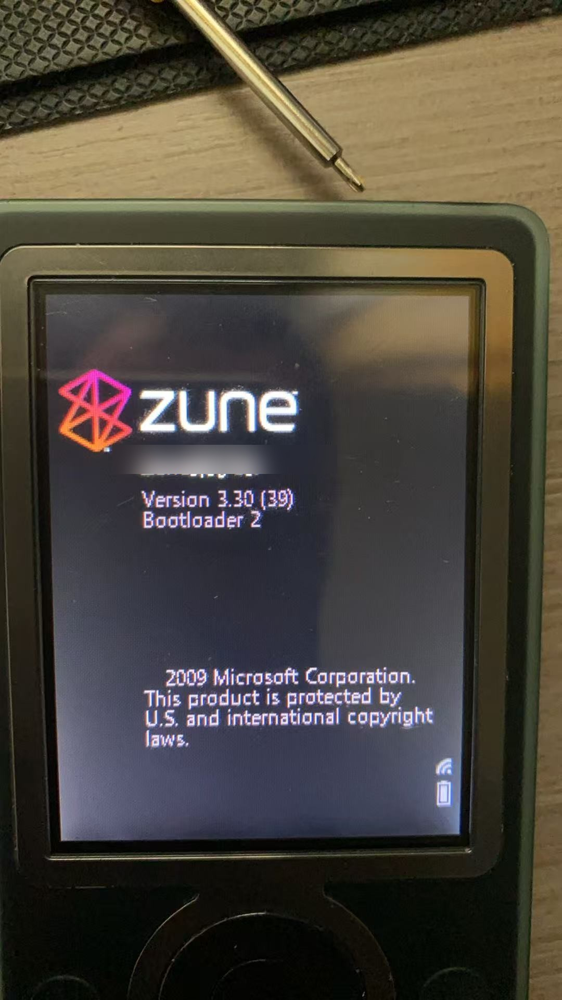
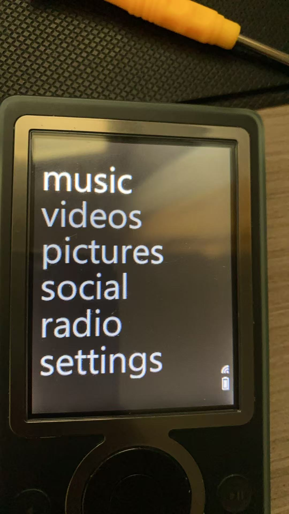
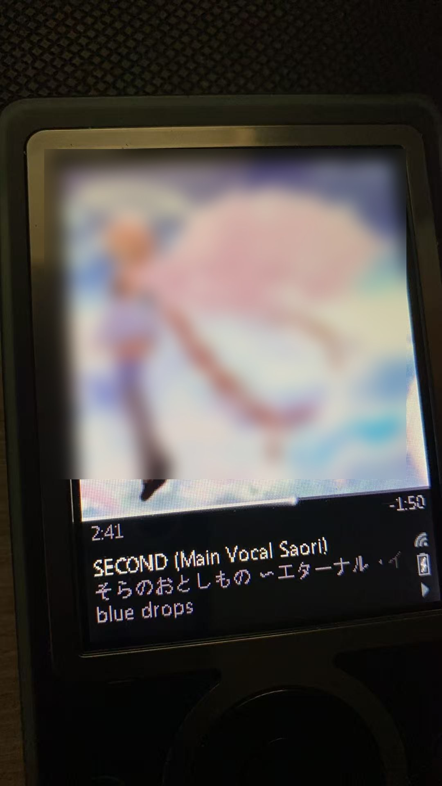
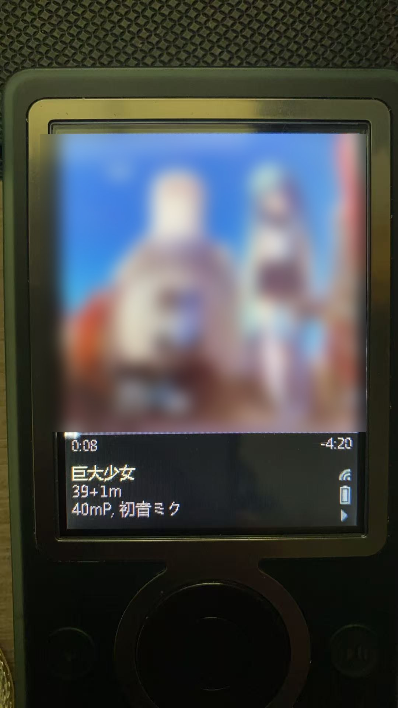

# Zune 30（Keel）——官方 3.3 固件原生显示中日文

**状态：已在真机验证通过**（i.MX31 Zune 30，30 GB，官方 3.3 (39) 固件）。

| 项目 | 修改前 | 修改后 |
|---|---|---|
| 设备名 | `Zune□□□` | `Zune示例名` |
| 中文歌名 | `□□□□` | `巨大少女` |
| 日文歌名 | `□□□□` | `そらのおとしもの ～エターナル・イ...` |
| 歌手 | `□□, □□□` | `40mP, 初音ミク` |

| 开机画面 | 主菜单 |
|---|---|
|  |  |

| 日文歌名 | 中文歌名 |
|---|---|
|  |  |

据公开资料，这是第一次有人在**官方 3.3 固件**上做到原生 CJK：

* 2009 年贴吧的中文方案只做到 **1.0 TEST / 1.4**；
* `zune30-research` 项目明确说明其 3.3 兼容镜像**不含中文**。

本仓库只包含**分析与脚本**，不分发任何微软固件、不包含任何商业字体。

---

## 核心原理（一句话）

3.3 的界面程序 `gemstone.exe` **不走 GDI 的字体回退（FontLink）**，它自己从 ROM 里读取三个文件：

```
\Windows\ZegoeUI.ttf        （常规）
\Windows\ZegoeUI_L.ttf      （细体）
\Windows\ZegoeUI_SB.ttf     （半粗，默认字体）
```

所以唯一改变 3.3 字体渲染的方法，就是**把这三个 ROM 文件的内容换成含 CJK 字形的字体**。

难点是 ROM 空间：空闲只有 36 KB，而中文字体动辄几百 KB。
解法：**原地压缩 `skin_default.gem`**（464 KB → 334 KB），腾出 130 KB 连续尾部空间，
再占用两个零售机不用的 `zdkscenes*.gem` 槽位，合计 163–180 KB 连续空间。

其他所有尝试（注册表 `Zune\Fonts\*` 的 Locator、GDI FontLink、FallbackFont、开机字体加载器）
在 3.3 上**全部无效**，详见 `docs/09-lessons-learned.md`。

---

## 前提：一个"宽松"的启动器

零售 3.3 的 EBoot 会对 `nk.bin` 验签（MinCrypt + HAB），任何改动都会导致拒绝启动，
甚至格式化整个 150 MB 系统分区。

突破口是 **1.0 TEST 的启动器**（sha256 前缀 `11D94DE4…`，开机显示 `Bootloader 2`）：
它被生产熔丝接受，但**不校验 `nk.bin`**。一旦它进入 NOR，之后随便改 `nk.bin` 都能启动。

> ⚠️ 这是整个工程最关键的资产。一旦被零售 EBoot 覆盖就**无法恢复**
> （EBoot 在 NOR 里、HAB 每次开机验签，改不了）。
> **永远不要让 Zune 软件"还原/修复设备"。**

---

## 镜像结构

```
nk.bin（B000FF 容器，110 条记录，base 0x88200000，ram_start 0x88f90000）
 ├── 官方 3.3 镜像                    （来自你自己的 KeelBaseline.cab）
 ├── AUTH196 补丁                     （开机时重封装旧 vault）
 ├── 版本号补丁                       （0x7cda6c，固定为 03.30.00039.00-00435）
 ├── skin_default.gem                 （原地压缩，flags |= 0x800）
 └── ZegoeUI*.ttf 三个条目            （全部指向同一个 CJK 字体，压缩存储）
```

* AUTH196 用公开的 `zune30-research` 工具、从**你自己的** NOR/vault 备份离线构建，
  含你的设备身份，**绝对不能公开**。
* CJK 字体是**去掉 hinting 的 TrueType 子集**（ASCII + 假名 + 曲库中 N 个高频汉字），
  内部字族名改成 `Zegoe UI Semibold`，用 CE-LZX 压缩，**块大小必须 4096**（其他大小解码器不接受）。

真机实测尺寸：

| 项目 | 数值 |
|---|---|
| 镜像 span | 13,956,899 B |
| ROM 尾部空隙 | 36,496 B |
| 三个 Zegoe 槽位（连续） | 112,948 B |
| `skin_default.gem` | 464,259 → 333,565 B |
| 字体可用连续空间 | 163,325 B（950 字）/ 180,776 B（1,050 字） |
| 无 hinting 字体（1,050 汉字 + 假名 + ASCII） | 231,240 → 177,460 B 压缩 |

---

## 目录结构

```
README.md                  英文说明
README.zh-CN.md            本文件
docs/
  01-background.md         硬件、启动链、三层保护
  02-lax-bootloader.md     1.0 TEST 启动器
  03-nor-vault-backup.md   不拆芯片读取 NOR / vault
  04-auth196.md            让 3.3 在旧 vault 上跑起来
  05-font-mechanism.md     字体加载机制（核心发现）
  06-rom-space.md          如何安全腾出 ROM 空间
  07-sync-fix.md           修复 C00D11CD 同步错误
  08-reproduction.md       完整复现步骤
  09-lessons-learned.md    所有失败尝试与原因
  10-publishing-checklist.md  去敏与发布检查清单
  ACKNOWLEDGEMENTS.md      详细致谢（中英）
scripts/
  build_cjk_font.py        子集化 + 去 hinting + 改名 + 体积校验
  patch_nk.py              版本补丁 + skin 压缩 + 字体注入 + 容器重建
  write_device.ps1         系统分区安全写入（重试 + 哈希校验）
NOTICE.md                  法律声明与致谢
```

---

## 快速复现（概要）

需要：Zune 30、ZIF 转 USB 适配器、一台 **1.0 TEST** 设备（或能装 TEST EBoot 的途径）、
你自己合法持有的官方 3.3 `KeelBaseline.cab`、以及你有权使用的中文 TTF。

1. **完整备份** —— NOR、vault、硬盘前 1 MB、`nk.bin`（见 `docs/03`）；
2. 安装 1.0 TEST 启动器（见 `docs/02`）；
3. 用你自己的 3.3 `nk.bin` + vault 构建 AUTH196（见 `docs/04`）；
4. 用 `scripts/build_cjk_font.py` 生成 CJK 字体子集；
5. 用 `scripts/patch_nk.py` 组装镜像（版本补丁 + skin 压缩 + 字体注入）；
6. 用 `scripts/write_device.ps1` 写入系统分区，开机。

详细步骤见 `docs/08-reproduction.md`。

---

## 注意事项

* **含设备身份的产物不要外传**（AUTH196 内含你的加密 vault）。
* **字体版权**：宋体 / MS Gothic / Gulim 都是商业字体，本仓库不含字体数据，
  请用你自己持有的字体生成子集。
* **变砖风险**：这是对 20 年旧设备的固件手术。宽松启动器让恢复变简单（重写 `nk.bin` 即可），
  但并非零风险。
* **绝不能让 Zune 软件"还原"设备。**
* `Acs_*.hex`（FM 收音机固件）和两个 `zdkscenes*.gem` 槽位被用作字体存储，
  因此收音机固件更新与 ZDK 示例场景不可用（Zune 的 FM/Wi-Fi 服务本身早已停摆）。
* 字库目前 1,050 个汉字，生僻字仍会显示方框。

---

## 致谢

* [`1977899016-cell/zune30-research`](https://github.com/1977899016-cell/zune30-research)：
  AUTH196 构建器、CE BIN/LZX 工具链、ROM 文件表知识——没有它就没有这一切。
* 2009 年 Zune 中文社区（贴吧）：证明 CJK 可行的 1.0 TEST / 1.4 方案。
* `ZuneDev` / Project Lyra：Zune 保存工作的先行者。

## 许可

文档与脚本：MIT。
不含任何微软二进制、字体文件或设备专属产物。

---

*本项目是对本人合法持有硬件的保存与互操作性研究，不分发任何受版权保护的固件或字体。*
